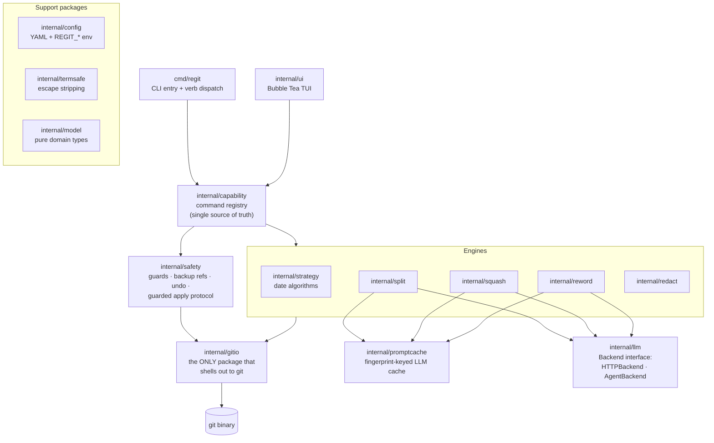

---
tags:
  - concepts
  - architecture
---

# Architecture

regit is a Go binary with two front ends — a Bubble Tea terminal UI and a mirrored headless
CLI — sitting on a single engine core. The layering rule is strict and one-directional:
`engines → capability → ui → cmd/regit`. The capability registry never imports the UI, and
`internal/gitio` is the only package in the codebase that shells out to the `git` binary.

## The capability registry (`internal/capability`)

The registry is the architectural centerpiece: every non-interactive action regit can perform
is one `Command` row in `registry.go` — name, typed parameters, positional spec, examples,
limits, and a headless `Run` function. Everything the user sees is a **projection** of that
table:

- **CLI dispatch** — `cmd/regit` looks the verb up in `capability.Registry()` and calls its
  `Run`; flag parsing and validation come from the row's typed `Param` list.
- **TUI action panel** — the `m` panel's rows are the registry joined to the UI's
  `featureBindings` by command name; an action exists in the TUI only if a registry row backs it.
- **`--help` and `--llm-help`** — the terse listing, per-verb help, and the agent-facing
  `regit --llm-help[=text|md|json]` document are all rendered from the same rows.
- **Transparency footer** — after each applied TUI action, `capability.Render` produces the
  exact `regit … --execute` line and logs it to `.git/regit/command.log`. A round-trip test
  guarantees `Render` is the inverse of `Parse`, so every logged line is one the CLI accepts.

Because all four surfaces derive from one table, they cannot drift apart: adding a verb is one
registry row (plus a name-keyed TUI closure if it has a TUI presence), and flag parsing, help,
the footer line, and the agent docs all update automatically.

## Front ends

**`cmd/regit`** — the entry point. `main.run()` handles `--version`, `--help`, `--llm-help`,
and the `git re` shim detection, extracts `--repo`, then either dispatches a verb through the
registry or launches the TUI. `dispatch.go` builds the `RunContext` (loaded config, opened
repo, output streams, clock) that every headless `Run` receives.

**`internal/ui`** — the Bubble Tea TUI: a persistent commit list + detail backbone, a flow
zone for interactive stages (the [redate](../reference/cli/redate.md) calendar), and the `m` action panel. It imports every
layer below it, including `capability`, and calls the **same** engine code the headless verbs
use — one code path, not two. Every history mutation funnels through the stage → preview →
confirm → apply pipeline before reaching the safety manager.

## Engines

Each feature area is its own package with no UI knowledge:

- **`internal/strategy`** — pure date-distribution algorithms ([Even Spread, Manual Pin, Rate
  Fill, …](../reference/cli/redate.md)). No git, no TUI, no LLM; fully unit-testable. It is the one engine that never
  touches `gitio` — it only computes day assignments that become a redate plan.
- **`internal/split`** — orchestrates splitting one commit: extract hunks, LLM grouping,
  cumulative tree building in a scratch worktree, validate/repair loop, and a final check that
  the last sub-commit reproduces the original tree exactly.
- **`internal/squash`** — collapses consecutive commit runs into one per chain, optionally
  asking the LLM to summarize the combined message.
- **`internal/reword`** — regenerates commit messages as ranked title/body variants; always
  gathers the commit's diff itself and sends it to the backend.
- **`internal/redact`** — finds a literal secret across history (`git log -S` pickaxe scan),
  follows each hit's line forward through rotations and renames (the cascade), and plans the
  per-commit line removals or replacements.

## Safety and git access

**`internal/safety`** — `Manager` runs the guarded apply protocol through one
op-parameterized skeleton (`runApply`): guards → preflight → backup ref → rewrite → content
verification → chain-structure verification → compare-and-swap branch move → applied-head
record → undo stack. Each operation contributes only its guards and rewrite closure, so a
protocol step added to the skeleton holds for every operation by construction. The full
sequence is on the [data flow](data-flow.md) page.

**`internal/gitio`** — the single choke point for the `git` binary, invoked via `os/exec`.
Reading history (`ReadCommits`), replaying with new dates (`Replay`), hunk extraction,
split/squash emission, change-set diffing for the verifier, and scratch-worktree isolation
(`NewWorktree`/`Close`) all live here. Rewrites use plumbing (`git commit-tree`) and reuse
the original tree objects, which is what makes byte-for-byte content preservation provable.
Adding a git call anywhere else breaks auditability and is forbidden by convention.

## LLM stack

**`internal/llm`** defines one `Backend` interface — `Generate(ctx, system, user, schema,
validate)` — with two implementations:

- **`HTTPBackend`** — POSTs to any OpenAI-compatible `/v1/chat/completions` endpoint
  ([ollama, LM Studio, OpenAI, OpenRouter](../reference/llm-providers.md)). It sends a `response_format` JSON schema — hosted
  providers honor it, local ones ignore it harmlessly — and validates the reply itself either
  way.
- **`AgentBackend`** — drives a local [agent CLI](../reference/llm-providers.md) (Claude Code by default) as a subprocess with
  the prompt on stdin, then parses the reply through the same validation.

The split, squash, and reword engines all build on this one call and cache results through
**`internal/promptcache`**, a shared fingerprint-keyed cache instantiated per engine under
`.git/regit/cache/`. The [data flow](data-flow.md) page covers the proposal/validation loop.

## Support packages

- **`internal/config`** — loads defaults → `$XDG_CONFIG_HOME/regit/config.yaml` →
  [`REGIT_*` environment overrides](../reference/configuration.md) (env always wins). It is the only place `os.Getenv` is read for
  configuration; loading is strict — unknown YAML keys or invalid values are hard errors.
- **`internal/termsafe`** — strips ANSI/OSC escape sequences and control bytes from untrusted
  text (commit subjects, authors, paths, LLM replies) before any render, so a crafted commit
  cannot spoof the terminal.
- **`internal/model`** — the pure domain vocabulary (`Commit`, `Plan`, `Hunk`,
  `SplitProposal`, `ChangeSet`, `Expectation`). Every other package imports it; it imports
  nothing from `internal/`.

## Related pages

- [Data flow](data-flow.md) — the guarded apply protocol step by step
- [CLI reference](../reference/cli/index.md) — every verb the registry projects
- [Configuration reference](../reference/configuration.md) — config keys and `REGIT_*` overrides
