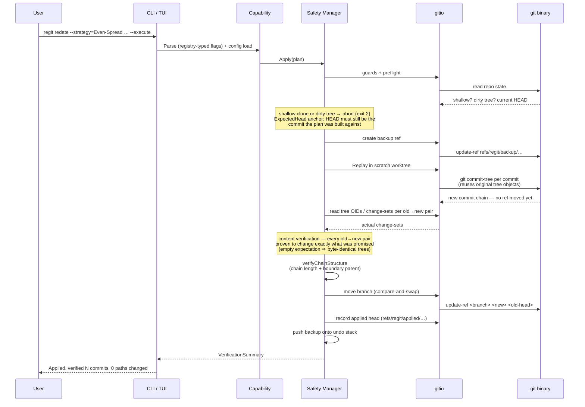

---
tags:
  - concepts
  - data-flow
---

# Data flow

Every history rewrite in regit — [redate](../reference/cli/redate.md),
[split](../reference/cli/split.md), [squash](../reference/cli/squash.md),
[reword](../reference/cli/reword.md), [retitle](../reference/cli/retitle.md),
[reauthor](../reference/cli/reauthor.md), [drop-bodies](../reference/cli/drop-bodies.md),
[purge](../reference/cli/purge.md), [redact](../reference/cli/redact.md),
[linearize](../reference/cli/linearize.md) — funnels through one guarded apply protocol,
implemented as a single op-parameterized skeleton (`safety.Manager.runApply`). Each operation
contributes only its guards and its rewrite closure; the protocol steps around them are shared,
so a safety property added to the skeleton holds for every operation by construction.

## The guarded apply protocol

Step by step:

1. **Parse and load** — the verb's flags are parsed and validated against its
   [registry row](architecture.md) (`capability.Parse`), config is loaded
   (defaults → YAML → [`REGIT_*` env](../reference/configuration.md)), and the repo is
   opened through [`gitio`](architecture.md).
2. **Guards and preflight** — a shallow clone or dirty working tree is a hard block (exit 2). "Dirty" means changes to tracked files; untracked files count only for `purge` and `redact`, which rewrite the checkout.
   `Manager.preflight` re-checks these **live** at apply time on every path, and anchors on
   `ExpectedHead`: the plan records the HEAD it was built against, and if the branch tip has
   moved since, the apply aborts rather than rewriting history it never previewed.
3. **Backup ref** — before anything is written, the current tip is saved under a
   branch-qualified `refs/regit/backup/…` ref.
4. **Rewrite via replay** — the new chain is built in an isolated scratch worktree using
   plumbing (`git commit-tree`), reusing the **original tree objects** so file content cannot
   change by construction. No branch ref has moved yet; a crash here leaves only unreferenced
   objects.
5. **Content verification** — before any ref moves, the verifier checks every old→new commit
   pair against the operation's declared `Expectation`. For the content-safe operations
   (redate, reword, split, squash, …) the expectation is empty, meaning the pair must be
   byte-identical — proven cheaply by comparing tree OIDs. Content-changing operations (purge,
   redact) declare exactly which paths may change, and the actual per-path change-set from
   `git diff --raw` must match it precisely.
6. **Chain-structure verification** — both first-parent chains are walked to prove the new
   chain has exactly the expected number of commits and sits on the same untouched boundary
   parent. A remap bug that dropped, duplicated, or reparented a commit would pass pairwise
   tree equality but fail this check.
7. **Branch move (compare-and-swap)** — the branch ref is moved with `update-ref`'s old-value
   check, so a concurrent HEAD move fails the swap instead of being silently clobbered.
8. **Record and stack** — the new head is recorded under `refs/regit/applied/…` (paired with
   its backup ref), and the backup is pushed onto the session undo stack.

A failure at any verification step aborts with the repo byte-for-byte unchanged: the branch
never moved, and only the backup ref and dangling objects remain.

## Preview vs `--execute`

Every mutating verb (except [`undo`](../reference/cli/undo.md),
[`install`, and `uninstall`](../reference/cli/install.md)) previews by default. A preview
run executes the whole planning path — parsing, guards, strategy or LLM proposal, plan
construction — and prints what would change, but never enters the apply protocol: no backup
ref, no replay against the branch, no ref moves. Adding `--execute` runs the identical plan
through the guarded apply; `--execute --force` is additionally required to rewrite commits
that are already pushed. In the TUI the same gradient appears as the mandatory before/after
preview overlay and, for pushed history, a typed branch-name confirmation.

[Exit codes](../reference/cli/index.md) are uniform across verbs: `0` ok or preview, `1`
usage error, `2` guard blocked, `3` apply/LLM error.

## Undo flow

`regit undo` restores the branch to the most recent regit backup ref (or a specific one via
`--to=`; `--list` is read-only). Both the in-app `U` key and the headless verb funnel through
the single implementation, `safety.Manager.Restore`. Undo has its own guards: each backup ref
is paired with an applied-head ref recording the tip its apply produced, and if the branch tip
no longer matches — meaning new commits or another apply happened since — undo refuses unless
`--force`. Before restoring, undo first backs up the *current* tip, so an undo is itself
reversible with `undo --to=<ref>`.

## The LLM proposal flow (split, reword, squash)

The LLM-backed verbs follow one rule: **the model proposes; the tool disposes.** The backend
returns structured data — a hunk grouping, message variants, a squash summary — which regit
validates in pure Go and then applies through the exact same guarded protocol above. The
model never touches the repository state.

1. **regit gathers the context itself** — the commit's diff, optional README/file-state
   context — and sends it in the prompt along with a JSON schema for the expected reply.
2. **The backend generates.** [`HTTPBackend`](architecture.md) sends `response_format` with the schema to any
   [OpenAI-compatible endpoint](../reference/llm-providers.md) — hosted providers honor it, local ones ignore it harmlessly —
   and regit validates the reply itself either way. [`AgentBackend`](architecture.md) runs the agent CLI with
   `--bare` for deterministic output (no user CLAUDE.md, hooks, or plugins), passes the prompt
   on stdin, and parses the reply envelope in order: `structured_output` → `result` → raw
   stdout, extracting JSON from the first `{` to the last `}`.
3. **Validation and retry.** Transport errors are retried unchanged. A reply that fails schema
   or invariant validation (e.g. a hunk grouping that misses a hunk) is retried with a
   strengthened prompt that appends the validation error — 2 attempts total, then the run
   fails with exit 3.
4. **Caching.** Validated proposals are cached per engine under `.git/regit/cache/` —
   repo-scoped, keyed by a fingerprint of every input that affects the output (content hash,
   model, parameters, schema version) and clock-free, so an identical preview and its later
   `--execute` reuse the same proposal without a second LLM call.
5. **Apply.** The accepted proposal becomes an ordinary plan and enters the guarded apply
   protocol — backup ref, replay, content and structure verification, compare-and-swap —
   identical to every non-LLM rewrite.

## Related pages

- [Architecture](architecture.md) — the packages behind each participant
- [CLI reference](../reference/cli/index.md) — flags for `--execute`, `--force`, and `undo`
- [Configuration reference](../reference/configuration.md) — LLM provider, model, and cache settings
